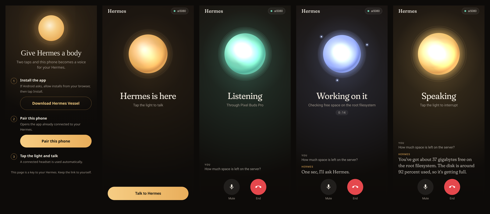

# Hermes Vessel

Give your Hermes Agent a phone as its body. Tap one button on an Android phone and you are in a live voice conversation with your own Hermes — screen off, phone in your pocket, Bluetooth headset in your ear.

- **The voice** runs on OpenAI Realtime (`gpt-realtime-2.1`) through **your ChatGPT sign-in** in Hermes — no API key.
- **The brain** is your Hermes, with its memory, skills and tools. Anything that needs real work (files, the web, your calendar, smart home, code) is handed to Hermes mid-conversation, and the answer is spoken back.
- **The phone** only moves audio. No keys or server addresses are baked into the app; it pairs with your Hermes from a link.



> Status: early build for the Nous Research plugin hackathon (November 2026). Voice and hand-off to Hermes are verified end to end with a simulated phone over a tailnet; real-phone testing is under way. Camera "eyes", proactive speech and an inner life between conversations are next.

## How it works

```
Android app ──WSS (PCM16 24 kHz + small JSON control)──▶ vessel plugin server (on your Hermes host)
                                                             │  ├─▶ OpenAI Realtime   (voice; session minted with your ChatGPT sign-in)
                                                             │  └─▶ Hermes API server (/v1/runs) for real work: ask_hermes(...)
```

Measured over a Tailscale tailnet: a reply starts about **1 second** after you stop talking. A hand-off to Hermes takes as long as the agent run (a few seconds to a minute); the voice says so instead of going silent.

## Requirements

- Hermes Agent with the **API server** enabled (`API_SERVER_KEY` set) — `ask_hermes` runs real agent turns through it.
- A ChatGPT subscription, signed in **inside Hermes**: `hermes auth add openai-codex --type oauth --no-browser` (a Codex CLI login does not count).
- An Android phone (8.0+) and a way for it to reach the Hermes host over HTTPS. The tested setup is [Tailscale](https://tailscale.com) on both, with `tailscale serve`.
- Python packages `aiohttp`, `httpx` and `qrcode`, declared in [`plugins/vessel/pyproject.toml`](plugins/vessel/pyproject.toml). Hermes asks for consent and installs them when you enable the plugin. No other plugin is needed.

## Install

Until the catalog entry lands:

```bash
git clone https://github.com/Ex8-ca/hermes-vessel
cp -r hermes-vessel/plugins/vessel ~/.hermes/plugins/vessel
hermes plugins enable vessel
```

## Get the app

On your Android phone, download **[hermes-vessel.apk](https://github.com/Ex8-ca/hermes-vessel/releases/latest/download/hermes-vessel.apk)** from the [latest release](https://github.com/Ex8-ca/hermes-vessel/releases/latest) and open it (allow installs from your browser if Android asks). The pairing page links to the same file. Each release is built from source by this repo's GitHub Actions, signed with the Hermes Vessel release key and carries a build attestation:

```bash
gh attestation verify hermes-vessel.apk --repo Ex8-ca/hermes-vessel
```

## Use

```bash
hermes vessel selftest      # mints a voice session, speaks one line, saves it as a WAV — no phone needed
hermes vessel selftest --voice coral --say "Hi, it's Hermes." --out coral.wav   # hear any voice
hermes vessel serve         # the phone link server on 127.0.0.1:8796
tailscale serve --bg --set-path /vessel http://127.0.0.1:8796   # tailnet-only HTTPS for the phone
hermes vessel pair          # prints a QR code and the pairing link
```

Scan the QR code with the phone's camera (or open the link on the phone): download the app, install it, tap **Pair this phone**, then tap the light.

**More than one Hermes:** pair each one the same way (its own `hermes vessel pair` link or QR code), or tap the gear → **Add a gateway** and paste a link. Settings lists every gateway by its full address (`ai5080.tailnet.ts.net/vessel`) with whether it's online, and calls go to the checked one: tap another to switch, or × to remove one. Pairing a gateway again replaces its token instead of adding a duplicate, and one that stops accepting this phone (its token was rotated) says so.

**Choosing a voice:** in the app, tap the gear (or the host chip) → **Voice**. Each of the ten voices has a play button for a short sample, and a tap picks it for your next call. The choice lives on the phone, so two phones can use different voices.

Settings (environment): `VESSEL_MODEL` (default `gpt-realtime-2.1`), `VESSEL_VOICE` (the default for phones that haven't picked one: `marin`; also `shimmer`, `coral`, `sage`, `alloy`, `cedar`, `ash`, `ballad`, `echo`, `verse`), `VESSEL_TURN_DETECTION` (`server_vad`, or `semantic_vad` if you pause mid-thought), `VESSEL_SILENCE_MS` (`550`), `VESSEL_API_SERVER_URL` (`http://127.0.0.1:6789`).

## The Android app

One light, one tap. The light breathes while Hermes is idle, turns jade and swells with your voice while it listens, gathers orbiting sparks while Hermes works on something (with a timer, so silence never feels dead), and glows gold as it speaks. Hermes's words appear as live captions in its own typeface; tap the light to interrupt. Calls work like phone calls (Mute, End, a notification with End call), keep running with the screen off, and use a connected headset automatically. A chip shows whether your Hermes is reachable before you tap, and pairing is one tap from a link or QR code (or paste the link). Settings has your Hermes gateways (switch, add, remove) and the voice picker (with samples).

Source in [`android/`](android/) (Kotlin, Jetpack Compose, OkHttp). The APK is built by this repository's GitHub Actions ([`.github/workflows/android.yml`](.github/workflows/android.yml)); tagged releases attach the APK with a GitHub build attestation. No binaries are committed — build locally with Gradle 8.14 (`gradle :app:assembleDebug` in `android/`, JDK 17). Tagging `v*` builds the signed release; the key lives only in the repository's Actions secrets.

The call runs in a foreground service (type `microphone`) with Android's voice-call audio path, so echo cancellation works on the speaker and a connected Bluetooth or wired headset is used automatically. You can talk over it to interrupt.

## What it does on your machine (disclosure)

- **Microphone:** while a call is active the phone streams microphone audio to the plugin server, which forwards it to OpenAI Realtime. Nothing is streamed when no call is active; the call shows an ongoing notification with a Hang up button.
- **The app download:** the pairing page sends the phone to this repo's GitHub release for the installed plugin version (`releases/download/v<version>/hermes-vessel.apk`). The plugin itself never downloads or runs a binary.
- **Background server:** `hermes vessel serve` listens on `127.0.0.1:8796`. Expose it only on your private network (for example `tailscale serve`, not Funnel).
- **The pairing token is a key to your Hermes:** whoever holds it can start voice sessions on your ChatGPT account and ask your Hermes to do things with your tools. It lives in `~/.hermes/plugin-data/vessel/pair_token` (mode 0600); delete the file and restart the server to rotate it.
- **Credentials:** the OpenAI session is minted through Hermes (`credentialed_provider_request`); the plugin never sees your ChatGPT token, only a short-lived session secret. The Hermes API key is read through Hermes's secret scope.
- **Voice samples:** the first time a phone plays a voice's sample, the server records one short line in that voice through OpenAI Realtime (one brief session on your ChatGPT sign-in) and caches it in `~/.hermes/plugin-data/vessel/voices/`; the phone caches it too. The voice list and samples need the pairing token.
- **Logs:** `~/.hermes/plugin-data/vessel/server.log` records connections, turn events and the first 200 characters of each request to Hermes and its answer. No audio is stored.
- **Persona:** the voice gets your `SOUL.md`, `USER.md` and the current local time as its instructions, so they are sent to OpenAI at the start of each call.

## Testing without a phone

[`tools/fake_phone.py`](tools/fake_phone.py) plays the phone against a running server: a typed turn that must go through Hermes, then real speech injected into a continuously streaming mic. Run it with Hermes's Python:

```bash
~/.hermes/hermes-agent/venv/bin/python tools/fake_phone.py wss://<your-host>/vessel/ws
```

Typeface: [Fraunces](https://github.com/undercasetype/Fraunces) by Undercase Type, SIL Open Font License 1.1 ([`android/third_party/fraunces/OFL.txt`](android/third_party/fraunces/OFL.txt)).

## Credits

[hermes-talk](https://github.com/TheSmokeDev/hermes-talk) by TheSmokeDev showed the way for realtime voice on the ChatGPT sign-in and the Hermes run bridge. This plugin is a separate, phone-first implementation.

## License

MIT
